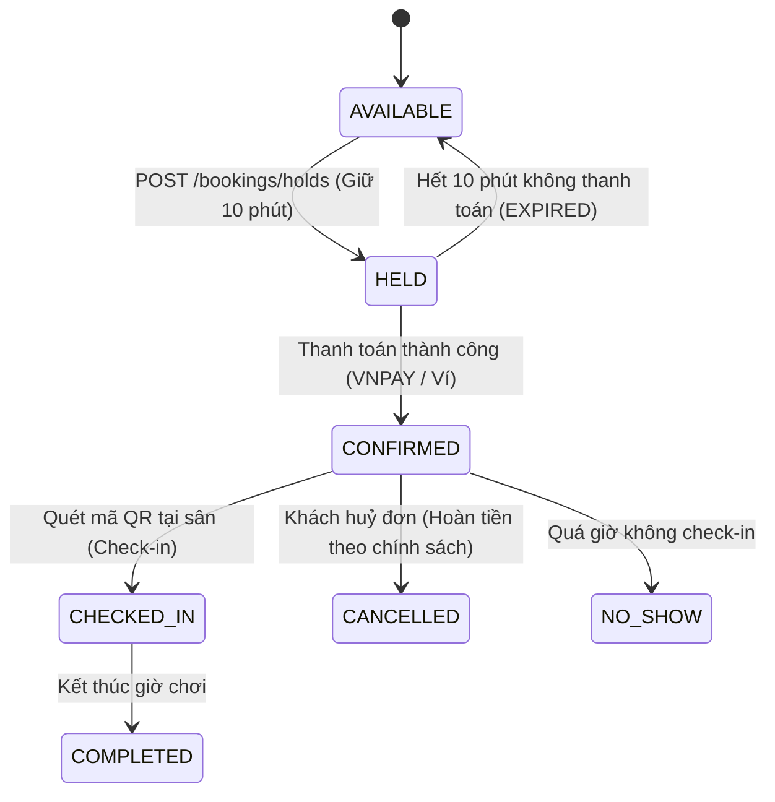

# ĐẶC TẢ TÁI CẤU TRÚC FRONTEND SANGO (WEB)
**Phiên bản:** 1.0.0 — Chuẩn hóa Contract-First từ Backend NestJS & `@sango/shared`  
**Ngày cập nhật:** 27/08/2026  
**Trạng thái:** Sẵn sàng cho triển khai (Ready for Implementation)

---

## MỤC LỤC
1. [Tổng Quan Kiến Trúc & Công Nghệ](#1-tổng-quan-kiến-trúc--công-nghệ)
2. [Hợp Đồng Dữ Liệu & Enums Chuẩn (@sango/shared)](#2-hợp-đồng-dữ-liệu--enums-chuẩn-sangoshared)
3. [Danh Mục Chi Tiết 21 API Controller Endpoints & RBAC](#3-danh-mục-chi-tiết-21-api-controller-endpoints--rbac)
4. [Các Luồng Nghiệp Vụ Cốt Lõi (Core State Machines & Flows)](#4-các-luồng-nghiệp-vụ-cốt-lõi-core-state-machines--flows)
5. [Bản Đồ Routing, Pages & Guards](#5-bản-đồ-routing-pages--guards)
6. [Thiết Kế Giao Diện & Design System Token](#6-thiết-kế-giao-diện--design-system-token)

---

## 1. TỔNG QUAN KIẾN TRÚC & CÔNG NGHỆ

### 1.1. Công nghệ Frontend mới
- **Framework & Core:** React 18+ (hoặc 19), TypeScript 5.7+, Vite 6+.
- **Styling & Tokens:** Tailwind CSS v4, Semantic CSS Variables (Light/Dark mode), Lucide Icons, clsx + tailwind-merge.
- **Data Fetching & Caching:** TanStack React Query v5 (kèm Query Key Factory có cấu trúc).
- **Client State & Session:** Zustand 5 (Auth Store, UI Preferences, Draft Filters).
- **Form Handling & Validation:** React Hook Form + Zod (tái sử dụng schemas từ `@sango/shared`).
- **Bản đồ & Định vị:** Leaflet + React-Leaflet (OpenStreetMap Tiles), Geolocation API browser, Haversine distance.
- **Tiện ích chuyên biệt:** QR Code SVG Pure TypeScript Generator (không phụ thuộc external library).

### 1.2. Cấu trúc thư mục định hướng (Feature-Driven Architecture)
```
apps/web/src/
├── assets/                  # Logo, icons, static assets
├── components/              # UI Component Primitives & Shared Layouts
│   ├── auth/                # ProtectedRoute, GuestRoute, RolesGuard
│   ├── layout/              # Header, Footer, PublicLayout, DashboardLayout, Sidebar
│   └── ui/                  # Button, Input, Dialog, Dropdown, Toast, Badge, Tabs, Card, Table...
├── features/                # Domain-driven feature modules
│   ├── auth/                # Login, Register, Forgot/Reset Password, Session Hook
│   ├── venues/              # Search, Grid, Venue Detail, Map View (Leaflet), Filter Sidebar
│   ├── booking/             # Slot Calendar, Hold Countdown, Checkout, Payment Result, QR Check-in, My Bookings
│   ├── wallet/              # Balance, Topup VNPAY/Mock, Ledger History
│   ├── teams/               # Team Management, Invites, Treasury/Fund Drive, Expense Split
│   ├── matches/             # Matchmaking (Kèo ghép trận), Join Requests, Comments
│   ├── tournaments/         # Knockout Bracket, Team Registration, Match Scores
│   ├── reputation/          # Karma Score, Tier Badges, Leaderboard
│   ├── notifications/       # Notification Center, Unread Badge, Push/In-App
│   ├── owner/               # Venue Management, Court CRUD, Time/Pricing Rules, Booking Queue, Check-in Scanner, Analytics
│   └── admin/               # Venue Approval Queue, User Management, System Stats
├── hooks/                   # useDebounce, useGeolocation, useMediaQuery, useCountdown
├── lib/                     # api-client (Axios/Ky + Interceptors), query-client, qrcode, formatters
├── routes/                  # router.tsx (React Router 6)
├── types/                   # Frontend-specific UI interfaces
├── App.tsx
├── main.tsx
└── index.css                # Tailwind base + Semantic CSS Theme Variables
```

---

## 2. HỢP ĐỒNG DỮ LIỆU & ENUMS CHUẨN (`@sango/shared`)

### 2.1. Danh mục Enums bắt buộc
| Enum | Các giá trị (Uppercase) | Mục đích sử dụng |
| :--- | :--- | :--- |
| `UserRole` | `CUSTOMER`, `OWNER`, `ADMIN` | Phân quyền RBAC toàn hệ thống |
| `UserStatus` | `ACTIVE`, `LOCKED` | Trạng thái tài khoản người dùng |
| `VenueStatus` | `PENDING`, `APPROVED`, `REJECTED`, `SUSPENDED` | Vòng đời kiểm duyệt cụm sân |
| `SportType` | `FOOTBALL5`, `FOOTBALL7`, `PICKLEBALL`, `BADMINTON`, `TENNIS` | Các môn thể thao hỗ trợ |
| `CourtStatus` | `ACTIVE`, `MAINTENANCE` | Trạng thái hoạt động của sân con |
| `DayType` | `WEEKDAY`, `WEEKEND` | Phân loại ngày áp dụng giá |
| `BookingHoldStatus` | `ACTIVE`, `CONVERTED`, `EXPIRED` | Trạng thái giữ chỗ tạm thời (TTL 10p) |
| `BookingStatus` | `CONFIRMED`, `CHECKED_IN`, `COMPLETED`, `CANCELLED`, `NO_SHOW` | Vòng đời đơn đặt sân |
| `PaymentType` | `DEPOSIT`, `FULL`, `REFUND`, `ADD_ON` | Loại giao dịch thanh toán |
| `PaymentMethod` | `VNPAY`, `MOCK` | Cổng thanh toán |
| `PaymentStatus` | `PENDING`, `PAID`, `FAILED`, `REFUNDED` | Trạng thái giao dịch tiền |
| `WalletLedgerDirection`| `CREDIT`, `DEBIT` | Chiều biến động ví cá nhân |
| `WalletLedgerType` | `TOPUP`, `PAYMENT`, `REFUND`, `CASHBACK` | Lý do biến động số dư ví |
| `MatchLevel` | `FRIENDLY`, `CASUAL`, `SCRIM`, `SEMI_PRO` | Trình độ kèo ghép / người chơi |
| `PreferredFoot` | `LEFT`, `RIGHT`, `BOTH` | Chân thuận hồ sơ cầu thủ |
| `TeamMemberRole` | `CAPTAIN`, `MEMBER` | Vai trò trong đội thể thao |
| `TeamMemberStatus`| `ACTIVE`, `PENDING` | Trạng thái tham gia đội |
| `FundDriveScope` | `MONTHLY`, `MATCH` | Phạm vi đợt thu quỹ đội |
| `FundDriveStatus` | `ACTIVE`, `CLOSED` | Trạng thái đợt thu quỹ đội |
| `TeamFundEntryType`| `INCOME`, `EXPENSE` | Sổ quỹ đội thu - chi |
| `TournamentStatus` | `REGISTRATION`, `ONGOING`, `FINISHED` | Vòng đời giải đấu |
| `TournamentMatchStatus`| `PENDING`, `READY`, `DONE` | Trạng thái trận đấu trong bracket |
| `NotificationType` | `BOOKING_CONFIRMED`, `BOOKING_CANCELLED`, `PAYMENT_RECEIVED`, `NEW_BOOKING_OWNER`, `MATCH_JOINED`, `MATCH_LEFT`, `REMINDER`, `WALLET`, `VOUCHER`, `SERVICE`, `TEAM`, `TOURNAMENT`, `MATCH_REQUEST`, `FUND_DRIVE` | Loại thông báo |

### 2.2. Nhóm môn thể thao (Sport Grouping)
- `FOOTBALL`: Gộp `FOOTBALL5` và `FOOTBALL7` (Bóng đá).
- `PICKLEBALL`: `PICKLEBALL` (Pickleball).
- `BADMINTON`: `BADMINTON` (Cầu lông).
- `TENNIS`: `TENNIS` (Tennis).

---

## 3. DANH MỤC CHI TIẾT 21 API CONTROLLER ENDPOINTS & RBAC

Mọi request API có tiền tố: `/api/v1`

### 3.1. Auth & Session (`/auth`)
- `POST /auth/register` (Public): Đăng ký `CUSTOMER` (`email`, `password`, `fullName`, `phone`). Trả `accessToken` + user, set cookie `refresh_token`.
- `POST /auth/login` (Public): Đăng nhập (`email`, `password`).
- `POST /auth/refresh` (Public / Cookie): Dùng refresh token trong cookie để lấy `accessToken` mới.
- `POST /auth/logout` (Public): Hủy refresh token & xóa cookie.
- `POST /auth/forgot-password` (Public): Gửi email khôi phục mật khẩu.
- `POST /auth/reset-password` (Public): Đặt lại mật khẩu bằng token.
- `PATCH /auth/change-password` (Auth): Đổi mật khẩu tài khoản hiện tại.

### 3.2. Users & Profile (`/users`)
- `GET /users/me` (Auth): Lấy thông tin tài khoản hiện tại.
- `PATCH /users/me` (Auth): Cập nhật hồ sơ (`fullName`, `phone`, `avatarUrl`, `bannerUrl`, `bio`, `favoriteSports`, `preferredPositions`, `preferredFoot`, `selfLevel`, `bankName`, `bankAccountNumber`, `bankAccountName`, `notifyEmail`, `notifyInApp`).

### 3.3. Venues — Khám Phá & Quản Lý Cụm Sân (`/venues`)
- `GET /venues` (Public): Tìm kiếm sân `APPROVED` (hỗ trợ `q`, `sportType`, `province`, `district`, `lat`, `lng`, `radiusKm`, `minPrice`, `maxPrice`, `page`, `limit`).
- `GET /venues/map` (Public): Lấy danh sách sân cho bản đồ theo khung nhìn viewport (`bbox=minLat,minLng,maxLat,maxLng`, `sportType`, `q`, `limit`).
- `GET /venues/:slug` (Public): Chi tiết cụm sân theo slug (kèm danh sách sân con `courts`, tiện ích, review, bảng giá).
- `GET /venues/mine` (OWNER/ADMIN): Danh sách cụm sân của chủ sân đăng nhập.
- `POST /venues` (OWNER/ADMIN): Đăng ký cụm sân mới (trạng thái ban đầu `PENDING`).
- `PATCH /venues/:id` (OWNER/ADMIN): Cập nhật thông tin cụm sân.

### 3.4. Courts — Sân Con (`/venues/:venueId/courts` & `/courts/:id`)
- `GET /venues/:venueId/courts` (OWNER/ADMIN): Danh sách sân con của cụm sân.
- `POST /venues/:venueId/courts` (OWNER/ADMIN): Tạo sân con mới (`name`, `sportType`, `slotMinutes`, `surfaceType`, `isIndoor`).
- `PUT /courts/:id` (OWNER/ADMIN): Cập nhật sân con / đổi trạng thái `ACTIVE` <-> `MAINTENANCE`.
- `DELETE /courts/:id` (OWNER/ADMIN): Xóa sân con (409 nếu đã có lịch đặt).

### 3.5. Pricing Rules — Bảng Giá Giờ Vàng (`/courts/:courtId/pricing-rules`)
- `GET /courts/:courtId/pricing-rules` (Public): Lấy danh sách quy tắc giá theo khung giờ & ngày thường/cuối tuần.
- `POST /courts/:courtId/pricing-rules` (OWNER/ADMIN): Tạo quy tắc giá (`startMinute`, `endMinute`, `price`, `dayType`).
- `PUT /courts/:courtId/pricing-rules/:id` (OWNER/ADMIN): Cập nhật quy tắc giá.
- `DELETE /courts/:courtId/pricing-rules/:id` (OWNER/ADMIN): Xóa quy tắc giá.

### 3.6. Bookings & Slots (`/courts/:courtId/slots` & `/bookings`)
- `GET /courts/:courtId/slots?date=YYYY-MM-DD` (Public): Ma trận trạng thái từng slot trong ngày (AVAILABLE, HELD, BOOKED, MAINTENANCE, giá từng slot).
- `GET /courts/:courtId/slots/week?from=YYYY-MM-DD&days=7` (Public): Xem nhanh lịch tuần.
- `POST /bookings/holds` (Auth): Giữ chỗ 10 phút (`courtId`, `date`, `slots: number[]`). Trả về `holdId`, `expiresAt`, `totalAmount`, `depositAmount`.
- `GET /bookings/me` (Auth): Danh sách đơn đặt của tôi (bộ lọc: `upcoming`, `history`, `cancelled`, `page`, `limit`).
- `GET /bookings/my-stats` (Auth): Thống kê số đơn đặt của tôi.
- `GET /bookings/:id` (Auth): Chi tiết đơn đặt sân, mã vé `CH-YYYYMMDD-NNNN`, mã QR check-in SVG/token, danh sách dịch vụ đi kèm.
- `GET /bookings/:id/refund-preview` (Auth): Xem trước số tiền hoàn lại theo chính sách (100% trước 24h, 50% trước 12h, 0% sau 12h).
- `POST /bookings/:id/cancel` (Auth): Huỷ đơn đặt sân và nhận hoàn tiền theo chính sách.
- `POST /bookings/:id/review` (Auth): Đánh giá cụm sân sau khi hoàn thành đơn (rating 1-5 sao, bình luận).
- `POST /bookings/check-in` (OWNER/ADMIN): Check-in bằng mã đơn hoặc quét QR code.
- `POST /bookings/:id/no-show` (OWNER/ADMIN): Đánh dấu khách không đến chơi (`NO_SHOW`).
- `GET /owner/bookings` (OWNER/ADMIN): Danh sách toàn bộ đơn đặt tại các sân của chủ sân.

### 3.7. Payments — Thanh Toán (`/payments`)
- `POST /payments/checkout` (Auth): Khởi tạo thanh toán (`holdId`, `type`: `DEPOSIT` | `FULL`, `paymentMethod`: `VNPAY` | `MOCK` | `WALLET`). Trả `paymentUrl` / `txnRef`.
- `GET /payments/vnpay/callback` (Public / Gateway): Xử lý phản hồi từ VNPAY (redirect về FE `/bookings/payment-result`).
- `GET /payments/mock/callback` (Public / Gateway): Xử lý callback chế độ Mock Payment.
- `GET /payments/status/:txnRef` (Auth): Kiểm tra trạng thái giao dịch thanh toán.

### 3.8. Wallets — Ví SanGo (`/wallet`)
- `GET /wallet/me` (Auth): Lấy số dư khả dụng (`balance`) và lịch sử biến động số dư (`ledger items`, phân trang).
- `POST /wallet/topup` (Auth): Tạo yêu cầu nạp tiền vào ví qua cổng VNPAY/Mock (`amount` >= 10.000đ). Trả về `paymentUrl`.

### 3.9. Vouchers — Mã Giảm Giá (`/owner/vouchers` & `/holds/:id/voucher`)
- `GET /owner/vouchers` (OWNER/ADMIN): Danh sách voucher của chủ sân.
- `POST /owner/vouchers` (OWNER/ADMIN): Tạo voucher (`code`, `percentOff`, `maxDiscountAmount`, `minBookingAmount`, `validFrom`, `validTo`, `usageLimit`, `applyOffPeakOnly`, `offPeakStartMinute`, `offPeakEndMinute`).
- `PATCH /owner/vouchers/:id` (OWNER/ADMIN): Cập nhật voucher.
- `DELETE /owner/vouchers/:id` (OWNER/ADMIN): Xóa voucher.
- `POST /holds/:id/voucher` (Auth): Áp dụng voucher vào đơn giữ chỗ `holdId`.
- `DELETE /holds/:id/voucher` (Auth): Gỡ voucher khỏi đơn giữ chỗ.

### 3.10. Venue Services — Dịch Vụ Đi Kèm (`/venues/:venueId/services` & `/bookings/:id/services`)
- `GET /venues/:venueId/services` (Public): Danh sách dịch vụ tiện ích tại sân (Nước giải khát, thuê áo bít, thuê vợt/bóng).
- `POST /venues/:venueId/services` (OWNER/ADMIN): Tạo dịch vụ mới (`name`, `type`, `price`, `unit`, `inStock`).
- `PATCH /services/:id` (OWNER/ADMIN): Cập nhật dịch vụ.
- `DELETE /services/:id` (OWNER/ADMIN): Xóa dịch vụ.
- `POST /bookings/:id/services` (Auth): Đặt thêm dịch vụ đi kèm cho đơn đặt sân đã xác nhận.

### 3.11. Teams & Treasury — Đội Thể Thao & Quỹ Đội (`/teams`)
- `POST /teams` (Auth): Tạo đội thể thao mới (Người tạo tự động là `CAPTAIN`).
- `GET /teams/my-teams` (Auth): Danh sách các đội tôi đã tham gia hoặc có lời mời `PENDING`.
- `GET /teams/:id` (Auth): Chi tiết đội, danh sách thành viên, số dư quỹ đội.
- `PATCH /teams/:id` (CAPTAIN): Cập nhật thông tin đội (`name`, `sport`, `logoUrl`, `description`).
- `POST /teams/:id/invite` (CAPTAIN): Mời thành viên bằng email hoặc link mời token.
- `POST /teams/:id/respond-invite` (Auth): Đồng ý (`accept: true`) hoặc từ chối (`accept: false`) lời mời vào đội.
- `DELETE /teams/:id/members/:userId` (Auth): Xóa thành viên (Captain xóa hoặc Member tự rời).
- `POST /teams/:id/fund-drives` (CAPTAIN): Mở đợt thu quỹ (`title`, `scope`: `MONTHLY` | `MATCH`, `targetAmountPerMember`, `dueDate`, `bookingId`).
- `POST /teams/:id/fund-drives/:driveId/contribute` (Auth): Đóng quỹ đội qua ví cá nhân hoặc tiền mặt.
- `POST /teams/:id/expenses` (CAPTAIN): Ghi nhật ký chi tiêu quỹ đội (`title`, `amount`, `category`, `receiptUrl`, `notes`).
- `GET /teams/:id/treasury` (Auth): Sổ cái thu chi quỹ đội (Số dư quỹ hiện tại, biểu đồ thu chi, danh sách đợt thu).
- `POST /teams/:id/split-booking` (CAPTAIN): Tự động chia tiền đơn đặt sân `bookingId` cho các thành viên tham gia.

### 3.12. Matches — Kèo Ghép Trận (`/matches`)
- `GET /matches/open` (Public): Danh sách các trận đang tìm người ghép (Lọc theo môn, cấp độ `MatchLevel`, khu vực, ngày giờ).
- `GET /matches/:id` (Public/Auth): Chi tiết kèo ghép (Sân, thời gian, chủ kèo, người đã tham gia, danh sách yêu cầu chờ duyệt, bình luận).
- `POST /matches/:id/requests` (Auth): Gửi yêu cầu xin tham gia kèo (`preferredPosition`, `message`).
- `GET /matches/:id/requests` (Chủ kèo): Danh sách người xin tham gia kèo.
- `PATCH /matches/:id/requests/:requestId` (Chủ kèo): Duyệt (`APPROVED`) hoặc từ chối (`REJECTED`) yêu cầu tham gia.
- `POST /matches/:id/comments` (Auth): Bình luận thảo luận trong kèo ghép.

### 3.13. Tournaments — Giải Đấu (`/tournaments` & `/matches`)
- `GET /tournaments` (Public): Danh sách các giải đấu trên hệ thống.
- `GET /tournaments/:id` (Public): Chi tiết giải đấu và bảng đấu trực quan (Single Elimination Bracket).
- `POST /tournaments` (OWNER/ADMIN): Tạo giải đấu mới.
- `POST /tournaments/:id/register` (CAPTAIN): Đăng ký đội vào giải đấu.
- `POST /tournaments/:id/start` (OWNER/ADMIN): Khóa đăng ký và tự động bốc thăm chia nhánh bracket.
- `PATCH /tournaments/matches/:id/score` (OWNER/ADMIN): Cập nhật tỉ số trận đấu giải và tự động đôn đội thắng vào vòng kế tiếp.

### 3.14. Reputation & Leaderboard (`/reputation`)
- `GET /reputation/me` (Auth): Điểm uy tín cá nhân, xếp hạng tier, lịch sử cộng trừ điểm (Đúng giờ +10, Huỷ sát giờ -5, No-show -20).
- `GET /reputation/leaderboard` (Public): Bảng xếp hạng người chơi uy tín nhất hệ thống.

### 3.15. Notifications — Trung Tâm Thông Báo (`/notifications`)
- `GET /notifications` (Auth): Danh sách thông báo in-app (phân trang).
- `GET /notifications/unread-count` (Auth): Số lượng thông báo chưa đọc (hiển thị badge chuông trên Navbar).
- `POST /notifications/:id/read` (Auth): Đánh dấu đã đọc 1 thông báo.
- `POST /notifications/read-all` (Auth): Đánh dấu đã đọc toàn bộ thông báo.

### 3.16. Analytics — Thống Kê Chủ Sân (`/owner/analytics`)
- `GET /owner/analytics?venueId=UUID&days=30` (OWNER/ADMIN): Thống kê doanh thu, số lượt đặt, tỷ lệ huỷ/no-show, biểu đồ chuỗi thời gian doanh thu ngày, top sân con có doanh thu cao nhất.

### 3.17. Admin Console (`/admin`)
- `GET /admin/venues` (ADMIN): Hàng chờ duyệt sân (Lọc `PENDING`, `APPROVED`, `REJECTED`, `SUSPENDED`).
- `GET /admin/venues/:id` (ADMIN): Chi tiết hồ sơ sân cần duyệt.
- `POST /admin/venues/:id/approve` (ADMIN): Duyệt cụm sân lên sàn.
- `POST /admin/venues/:id/reject` (ADMIN): Từ chối sân kèm lý do.
- `POST /admin/venues/:id/suspend` (ADMIN): Tạm ngưng hoạt động cụm sân.
- `POST /admin/venues/:id/unsuspend` (ADMIN): Khôi phục hoạt động cụm sân.
- `GET /admin/users` (ADMIN): Quản lý người dùng toàn hệ thống (Tìm kiếm, phân quyền, khóa `LOCKED`/mở khóa `ACTIVE`).
- `PATCH /admin/users/:id/status` (ADMIN): Khóa hoặc kích hoạt tài khoản.
- `GET /admin/stats` (ADMIN): Thống kê tổng quan toàn sàn (Tổng doanh thu GMV, tổng người dùng, tổng sân, biểu đồ tăng trưởng).

### 3.18. AI Chat Assistant (`/ai`)
- `POST /ai/chat` (Public/Optional Auth): Trợ lý AI tư vấn tìm sân, gợi ý slot còn trống và hỗ trợ đặt sân bằng tiếng Việt tự nhiên (Rate limit 20 tin nhắn/giờ).
- `GET /ai/suggested-slots` (Public): Gợi ý các khung giờ đẹp còn trống dựa theo sở thích người chơi.

### 3.19. Health Check (`/health`)
- `GET /health` (Public): Kiểm tra trạng thái hoạt động của Backend API (`{ status: 'ok' }`).

---

## 4. CÁC LUỒNG NGHIỆP VỤ CỐT LÕI (CORE STATE MACHINES & FLOWS)

### 4.1. Luồng Giữ Chỗ & Đặt Sân (Booking & Hold Lifecycle)


- **Quy tắc thời gian (Time Integrity):** Mọi tính toán giờ dựa trên số phút trong ngày (0 -> 1440) và ngày theo múi giờ `Asia/Ho_Chi_Minh` (`vnToday()`).
- **Khóa giữ chỗ (Hold Slot):** Đảm bảo không xảy ra race condition (double-booking) khi nhiều khách cùng chọn 1 khung giờ.

### 4.2. Luồng Hoàn Tiền Huỷ Đơn (Refund Policy)
- **Hủy trước >= 24 giờ:** Hoàn **100%** tiền cọc/thanh toán về Ví SanGo.
- **Hủy trước 12 - 24 giờ:** Hoàn **50%** tiền cọc/thanh toán về Ví SanGo, trừ 5 điểm uy tín.
- **Hủy dưới < 12 giờ:** Hoàn **0%**, trừ 5 điểm uy tín.

---

## 5. BẢN ĐỒ ROUTING, PAGES & GUARDS

Toàn bộ đường dẫn URL được chuẩn hóa thân thiện (Clean URLs):

### 5.1. Khu Vực Công Khai & Khách Hàng (PublicLayout)
| Đường dẫn URL | Tên Trang | Mô tả & Chức năng |
| :--- | :--- | :--- |
| `/` | `HomePage` | Trang chủ: Hero tìm kiếm nhanh, sân nổi bật, review, banner |
| `/venues` | `VenuesPage` | Danh sách sân: Bộ lọc quận/môn/giá/giờ, tìm kiếm GPS, phân trang |
| `/venues/:slug` | `VenueDetailPage` | Chi tiết cụm sân: Ảnh, tiện ích, sân con, bảng giá, reviews |
| `/venues/:slug/book` | `BookingCalendarPage` | Lịch đặt sân: Chọn ngày, chọn sân con, slot matrix, giữ chỗ |
| `/map` | `MapPage` | Bản đồ toàn màn hình: Marker vị trí sân, GPS gần tôi, card nổi |
| `/matches` | `MatchesPage` | Sàn ghép trận: Tìm đối giao lưu, xem danh sách kèo mở |
| `/matches/:id` | `MatchDetailPage` | Chi tiết kèo ghép: Tham gia, duyệt thành viên, bình luận |
| `/tournaments` | `TournamentsPage` | Danh sách giải đấu thể thao |
| `/tournaments/:id` | `TournamentDetailPage`| Chi tiết giải đấu: Cây nhánh bảng đấu (Bracket), lịch thi đấu |
| `/ranking` | `RankingPage` | Bảng xếp hạng uy tín và người chơi tích cực |
| `/about` | `AboutPage` | Giới thiệu nền tảng SanGo |
| `/partner` | `PartnerPage` | Dành cho chủ sân thể thao & form đăng ký mở sân |

### 5.2. Khu Vực Tài Khoản & Khách Đã Đăng Nhập (`ProtectedRoute` - All Users)
| Đường dẫn URL | Tên Trang | Mô tả & Chức năng |
| :--- | :--- | :--- |
| `/bookings` | `MyBookingsPage` | Đơn đặt của tôi: 4 tabs (Tất cả/Sắp tới/Hoàn thành/Đã huỷ), mã QR, huỷ đơn |
| `/bookings/hold/:holdId`| `CheckoutHoldPage` | Trang Checkout: Chọn cọc/trả đủ, áp voucher, chọn cổng thanh toán |
| `/bookings/payment-result`| `PaymentResultPage` | Kết quả thanh toán: Vé điện tử, mã QR SVG check-in |
| `/wallet` | `WalletPage` | Ví cá nhân: Số dư, nạp tiền VNPAY, lịch sử thu chi |
| `/teams` | `MyTeamsPage` | Danh sách đội của tôi & lời mời gia nhập |
| `/teams/new` | `CreateTeamPage` | Tạo đội thể thao mới |
| `/teams/join` | `TeamJoinPage` | Nhập mã mời / link mời tham gia đội |
| `/teams/:teamId` | `TeamDetailPage` | Chi tiết đội: Thành viên, quỹ đội (Treasury), chia tiền sân |
| `/notifications` | `NotificationsPage`| Trung tâm thông báo hệ thống |
| `/profile` | `ProfilePage` | Hồ sơ cá nhân: Đổi avatar, môn thể thao yêu thích, vị trí đá, chân thuận |

### 5.3. Khu Vực Xác Thực Khách (`GuestRoute` - Chưa đăng nhập)
| Đường dẫn URL | Tên Trang | Mô tả |
| :--- | :--- | :--- |
| `/login` | `LoginPage` | Đăng nhập tài khoản |
| `/register` | `RegisterPage` | Đăng ký tài khoản mới |
| `/forgot-password` | `ForgotPasswordPage` | Quên mật khẩu |
| `/reset-password` | `ResetPasswordPage` | Đặt lại mật khẩu mới |

### 5.4. Khu Vực Chủ Sân (`ProtectedRoute` - `OWNER` / `ADMIN`) (`DashboardLayout`)
| Đường dẫn URL | Tên Trang | Mô tả |
| :--- | :--- | :--- |
| `/dashboard/owner/venues` | `OwnerVenuesPage` | Quản lý danh sách cụm sân của tôi |
| `/dashboard/owner/venues/new`| `CreateVenuePage` | Đăng ký cụm sân mới |
| `/dashboard/owner/venues/:id`| `VenueSettingsPage`| Sửa thông tin cụm sân, quản lý sân con, bảng giá giờ vàng |
| `/dashboard/owner/bookings` | `OwnerBookingsPage` | Quản lý lịch đặt sân, duyệt check-in vé, đánh dấu No-Show |
| `/dashboard/owner/vouchers` | `OwnerVouchersPage` | Quản lý mã giảm giá giờ thấp điểm |
| `/dashboard/owner/services` | `OwnerServicesPage` | Quản lý dịch vụ tiện ích bán kèm |
| `/dashboard/owner/analytics`| `OwnerAnalyticsPage`| Thống kê doanh thu, biểu đồ ngày, top sân con |

### 5.5. Khu Vực Quản Trị Hệ Thống (`ProtectedRoute` - `ADMIN`) (`DashboardLayout`)
| Đường dẫn URL | Tên Trang | Mô tả |
| :--- | :--- | :--- |
| `/dashboard/admin/stats` | `AdminStatsPage` | Tổng quan sàn, GMV, biểu đồ người dùng |
| `/dashboard/admin/venues` | `AdminVenuesPage` | Hàng chờ duyệt cụm sân (Duyệt / Từ chối / Đình chỉ) |
| `/dashboard/admin/users` | `AdminUsersPage` | Quản lý danh sách tài khoản, khóa / mở khóa |

---

## 6. THIẾT KẾ GIAO DIỆN & DESIGN SYSTEM TOKEN

### 6.1. Bảng Màu Thể Thao Cao Cấp (Color Palette)
- **Primary / Sport Action:** `Emerald-500` / `Emerald-600` (`#10b981` / `#059669`) — Đại diện cho mặt cỏ thể thao, năng động và tin cậy.
- **Secondary / Accent:** `Amber-500` (`#f59e0b`) — Giờ vàng, voucher, điểm uy tín.
- **Surface & Backgrounds (Dark/Light Responsive):**
  - Light mode: Nền `bg-slate-50`, thẻ `bg-white`, viền `border-slate-200`.
  - Dark mode: Nền `bg-slate-950`, thẻ `bg-slate-900`, viền `border-slate-800`.
- **Typography:** `Inter` hoặc `Outfit` kết hợp `font-mono` cho các thông số thời gian, mã vé, tiền tệ VND.

### 6.2. Các Thành Phần Giao Diện Nền Tảng Cần Xây Dựng
1. `Button` (Variants: `default`, `outline`, `ghost`, `destructive`, `secondary`).
2. `Input`, `Textarea`, `Select`, `Checkbox`, `RadioGroup`.
3. `Dialog` / `Modal` (Radix UI Slot).
4. `DropdownMenu` (Menu tài khoản, bộ lọc).
5. `Badge` (Status indicators: Xanh, Đỏ, Vàng, Xám).
6. `Card` (Venue card, Booking ticket card, Match card).
7. `Tabs` (Tab chuyển đổi trạng thái đơn, thống kê).
8. `Toast` / `Toaster` (Thông báo realtime thành công / lỗi có âm báo).
9. `QRCodeRenderer` (Vẽ SVG ma trận QR code check-in tức thì).
10. `InteractiveMap` (Bản đồ Leaflet tự động resize chống xé hình).

---
*Tài liệu này là bản quy chuẩn hợp đồng kỹ thuật cho toàn bộ giai đoạn tái cấu trúc Frontend SanGo.*
